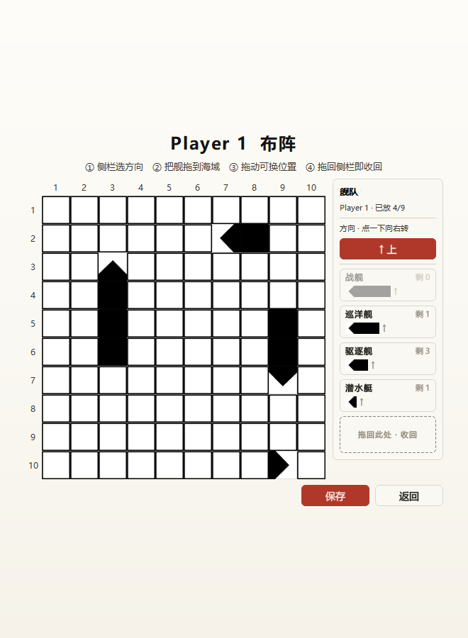
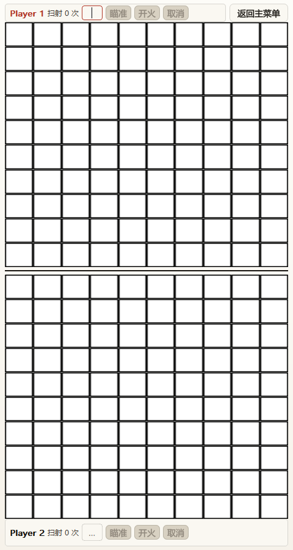

# Battle Ship · 海战棋

刚上大学时很喜欢漫画《噬谎者》，里面有个海战棋的游戏，直接用Qt搞了一个，现在这个年代 token 滞销了就拿出来翻新了一版，直接 vibe 实现以前不知道怎么搞的拖拽布局很舒服，了却当初遗憾

用 **C++17 + Qt 5 Widgets** 写的单机双人回合制海战棋。两位玩家共用一台设备，各守一片 10 × 10 海域、各布置 9 艘舰，轮流点击对方海域开火，先打光对方舰队者获胜。

特色是「**一同扫射**」：每击沉一艘舰攒 1 次额度，1 次额度可同时打 5 格，额度能累积、能一次用完。没有 AI、没有联机、没有存档，也没有任何第三方依赖。

| 布阵阶段 | 对战阶段 |
| :---: | :---: |
|  |  |

> 视觉是黑白漫画风：墨（近黑）、纸（暖白）、朱红（点缀）三色，素材来自 `resources/Image/`。

---

## 玩法

### 舰队编制

每方 9 艘舰，共占 20 格。一艘舰的**每一格都被揭开**才算击沉。

| 舰种 | 长度 | 数量 | 占格 |
| --- | ---: | ---: | ---: |
| 战舰 Battleship | 4 | 1 | 4 |
| 巡洋舰 Cruiser | 3 | 2 | 6 |
| 驱逐舰 Destroyer | 2 | 4 | 8 |
| 潜水艇 Submarine | 1 | 2 | 2 |
| **合计** | — | **9** | **20** |

这张表在 `src/core/Rules.h` 的 `kFleet` 里定义，界面侧栏的剩余数、规则页的编制表都由它派生。

### 一局怎么走

1. **布置**：主菜单点 `Player1` 或 `Player2`，分别进入各自的海域布阵（布置时请让对方回避）。
   - 先在右侧舰队面板选方向：点一下方向按钮顺时针转 90°，上 → 右 → 下 → 左。
   - 把舰种从侧栏**拖到棋盘**上松手即落子；拖动时棋盘显示半透明虚影，合法为墨灰、非法为朱红。
   - 放错了直接在棋盘上**抓住那艘舰拖到别处**换位置；拖回侧栏底部的虚线框则整艘收回。
   - 越界或与已有舰重叠会被拒绝，且不会留下半截船体。9 艘放完点「保存」，两方都布好后回主菜单点「开始」。
2. **开战**：`Player1` 先手。对战页上下两块棋盘，行动条标题染成朱红的一方正在行动。
3. **进攻**：只能点**对方**那片海域，点自己的棋盘没有效果。同一格一局只记录一次，重复点击无效。

### 开火结果

| 结果 | 画面 | 后续 |
| --- | --- | --- |
| **落空** | 红叉（Miss） | **换对方行动**，且本方累积的扫射额度清零 |
| **命中** | 揭开并显示舰型 | 继续进攻，**不**获得扫射额度 |
| **击沉** | 该舰所有格揭开 | 继续进攻，攻击方 **+1 次一同扫射** |
| 重复点击已揭开的格 | — | 被忽略（`AlreadyResolved`） |

### 一同扫射（Volley）

- 在行动条输入框填**次数**（不是格数），点「瞄准」；每 1 次 = 选 5 格，例如填 2 就要选 10 格。
- 依次点选目标格（再点一次可取消选中），点「开火」齐射，点「取消」退回单发。
- **0 命中** → 额度清零 + 换手；**有命中** → 保持行动权。
- 扫射命中只显示通用爆点，**不暴露舰型**；只有该舰被击沉才显示船型。

### 胜负

对方 9 艘舰全部击沉即获胜，判给攻击方，之后不再接受任何操作。中途可随时点「返回主菜单」退出，已布置的舰队会保留。

游戏内「规则说明」页有同样的六章节手册（目标 / 舰队编制 / 布置海域 / 轮流进攻 / 一同扫射 / 版面图例），带漫画原作插图和图例。

---

## 快速开始

### 直接运行（Windows 64 位）

从 [Releases · v1.0.0](https://github.com/kiqsont/BattleShip/releases/tag/v1.0.0) 下载 `BattleShip-1.0.0-win64.exe`。**只有一个 exe，双击即玩**：无需安装、无需 Qt 环境、无需手动解压；运行时把随附的运行库释放到系统临时目录，退出后自动清理。首次启动会有几秒释放过程。

> 仓库当前为私有，下载 Release 资产需要登录 GitHub。该 exe 由 Qt 5.14.2 / MinGW 7.3 64-bit 从本分支源码 Release 编译，SHA-256 见 Release 说明。

### 从源码构建

环境：Qt 5.12+（`Core Gui Widgets`，推荐 5.14.2）、支持 C++17 的编译器、CMake ≥ 3.16（或 qmake）。

```bash
# CMake（推荐）；把 CMAKE_PREFIX_PATH 换成自己的 Qt 安装路径
cmake -G "MinGW Makefiles" -DCMAKE_PREFIX_PATH=D:/Qt/5.14.2/mingw73_64 -B build
cmake --build build
(cd build && ctest --output-on-failure)

# qmake（兼容路径，产物在 release/ 或 debug/）
qmake BattleShip.pro
mingw32-make
```

`BattleShip.pro` 与 `CMakeLists.txt` 的源文件清单需手工保持同步——新增源文件时两处都要加。

测试是 QtTest，共 35 例，直接链接静态库、无需显示器（`tst_ui` 用 `-platform offscreen`）：

| 目标 | 用例 | 覆盖 |
| --- | ---: | --- |
| `tst_board` | 8 | 布置/越界/重叠、整艘删除、命中与击沉、编制剩余数 |
| `tst_gamesession` | 8 | 回合、额度、齐射、胜负归属、重开清空 |
| `tst_ui` | 19 | 页面导航、拖放落子与虚影、方向轮换、点击连通性、布局 |

---

## 架构

### 分层

```
┌──────────────────────────────────────────────────────────────┐
│  src/ui/                        纯展示：只渲染状态、把点击翻译成意图 │
│  MainWindow ──┬── MenuPage ── MenuButton                      │
│               ├── PlacementView ── BoardWidget ── CellButton   │
│               │                 └── ShipPalette / ShipDrag      │
│               ├── BattleView ── TurnBar / BoardWidget          │
│               └── RulesView                                    │
│  横切：Theme（颜色字体） / Pixmaps（贴图） / GameControls（控件样式） │
└───────────────────────────┬──────────────────────────────────┘
                   调用方法 ↓  │  ↑ 信号（单向依赖：ui → core）
┌───────────────────────────▼──────────────────────────────────┐
│  src/core/                       纯逻辑：只依赖 QtCore，可单测    │
│  GameSession ── Board[2] ── Ship[*]                           │
│  常量与值类型：Rules / Types                                    │
└──────────────────────────────────────────────────────────────┘
```

三条设计约束：

1. `core/` 不 `#include <QWidget>`、不弹窗，错误一律用枚举返回（`PlacementError` / `ShotResult`）。
2. `ui/` 不持有规则状态——「能不能放、还剩几次、该谁走」一律问 `GameSession` 或 `Board`。
3. 跨页跳转只经 `MainWindow` 的 `QStackedWidget`，View 之间互不 `#include`。

`GameSession` 是 core 里唯一的 `QObject`；`Board` / `Ship` 是纯数据，视图按需轮询 `view()`。因此逻辑层可以脱离界面被单元测试直接构造。

### 构建目标

| 目标 | 类型 | 内容 |
| --- | --- | --- |
| `battleship_core` | STATIC | `core/` 全部文件，链接 `Qt5::Core` |
| `battleship_ui` | STATIC | `ui/` 全部文件，链接 `battleship_core` + `Qt5::Widgets` |
| `BattleShip` | WIN32 可执行 | 仅 `src/main.cpp` + `resources/res.qrc` |

### 目录

```
src/
├── main.cpp                  入口：设全局字族 → 显示 MainWindow
├── core/
│   ├── Types.h/.cpp          棋盘尺寸、枚举（Side/ShipType/Direction/ShotResult）、Coord 几何
│   ├── Rules.h/.cpp          舰队编制 kFleet、编制查询、每次扫射 5 格
│   ├── Ship.h/.cpp           单舰：船头 + 朝向 + 命中数
│   ├── Board.h/.cpp          10×10 棋盘：布置/删除/开火/只读视图
│   └── GameSession.h/.cpp    对局状态机：回合、扫射额度、选中格、胜负
└── ui/
    ├── MainWindow            四页导航 + 纸面背景
    ├── MenuPage/MenuButton   主菜单（响应式两套版式）
    ├── PlacementView         布阵页：棋盘 + 舰队侧栏 + 拖放
    ├── ShipPalette/ShipDrag  侧栏、拖拽载荷与落点换算
    ├── BattleView/TurnBar    对战页、两侧行动条
    ├── BoardWidget/CellButton 棋盘控件（布置页复用为拖放目标）与单格自绘
    ├── RulesView             可滚动规则手册
    └── Theme/GameControls/Pixmaps  视觉主题、控件样式、贴图缓存
resources/                    res.qrc + Image/*.png（Qt 资源系统，前缀 :/）
tests/                        tst_board / tst_gamesession / tst_ui
docs/                         PROJECT_KNOWLEDGE_BASE.md、REFACTORING_PLAN.md
```

### 核心模型与状态机

- **Ship** 不存格子数组，用「船头坐标 + 朝向 + 舰种长度」现算船体；`Board` 用 `m_owner[100]` 记录每格归属、用 `m_resolved[100]` 记录是否已揭开，删除整艘时会同步修正后续下标。
- **`GameSession::Phase`**：`Placement ──beginBattle()──► Battle ──对方全灭──► Finished`。注意页面切换与 Phase 不是一回事：布阵页只改 `Board`，点「开始」才进入 `Battle`。
- **core → UI 只靠 5 个信号**：`battleStarted()`、`turnChanged(side)`、`cellChanged(boardOwner, coord)`（只刷一格）、`sideStateChanged(side)`（刷行动条）、`finished(winner)`。

一次普通点击的数据流：

```
CellButton 点击 → BoardWidget → BattleView::onCellActivated()
    → GameSession::fireAt(当前方, 坐标) → Board::shoot()
    → emit cellChanged / sideStateChanged → BattleView 刷新对应格与行动条
    → 落空则 emit turnChanged → 全量刷新；全灭则 emit finished → 弹出胜负
```

### 几个值得留意的实现点

- **改玩法只动常量**：舰队编制、舰长、棋盘尺寸、每次扫射格数分别集中在 `Rules.h` / `Types.cpp` / `Types.h` / `Rules.h`。
- **落点虚影只改视觉**：拖动时备份被盖住的格子外观，松手前不写 `Board`；合法性只有一个判断入口 `PlacementView::checkDrop()`。
- **拖动已放置的舰**会记住「抓住的是船体第几格」（`grabOffset`），落点减去偏移得到新船头，位置不会跳。
- **齐射命中不暴露舰型**：`BattleView` 记住本局齐射打过的格子，`CellButton` 把未击沉的命中渲染成通用爆点。
- **视觉单一来源**：颜色、字体、纸面绘制都收敛在 `Theme.cpp`；贴图统一由 `Pixmaps` 缓存缩放；`CellButton` 只持有外部写入的 `CellVisual`，不碰游戏状态。

---

## 文档与已知限制

深入资料：

- `docs/PROJECT_KNOWLEDGE_BASE.md` —— 项目单一事实来源：规则权威清单、状态机、逐模块说明、常见改动索引、技术债。
- `docs/REFACTORING_PLAN.md` —— 重构全过程与旧版缺陷记录。
- `Battle Ship.docx` —— 原始设计文档，规则出处。

限制：

- 单机双人同设备，无 AI、无联机、无存档；构建配置以 Windows 为主。
- **开战前请双方都放满 9 艘舰**。当前代码不强制放满，而空舰队开战时胜负判定不会触发（详见知识库 §13.1）；这是已知待修项。
- 齐射过程中击沉的舰不再累积扫射额度（设计文档未明确的边界）。
- 无 CI，测试需本地 `ctest`；Qt6 迁移未做。
